# Stripe Analytics

A desktop app (Electron + TypeScript) for Linux and Windows that builds regulatory reports from
your Stripe invoices, using a read-only key.

## What it's for

[Vaslabs](https://vaslabs.io), a company registered in Cyprus that bills its customers through
Stripe, built this for two recurring filings:

1. **Central Bank statistics.** Each calendar quarter, the Central Bank of Cyprus collects the
   Services Survey (QSRVS) through its EDX e-business platform. The **Revenue** tab gives
   the revenue side of it, paid invoice totals per customer country and currency for the
   quarter, with a EUR view, a currency mix and a service view (revenue per Stripe tax code, by
   country), since the survey asks for each type of service separately.
2. **VAT and VIES returns.** The **Cyprus VAT** tab splits a VAT quarter's invoices into domestic
   (output VAT owed), EU B2B (the monthly VIES listing, per customer VAT number) and
   international, and flags invoices whose tax treatment looks wrong. Cyprus VAT quarters have
   traditionally been staggered (Mar–May, Jun–Aug, Sep–Nov, Dec–Feb) and are moving to calendar
   quarters, so the tab supports both.

The same tab also breaks revenue down **per product**, **per client** and **per contractor** (products
assigned to people in Options), in the invoice currencies or converted to EUR.

It's published as-is in case it helps someone with the same setup. It assumes a Cyprus VAT
registration and supports only EUR, GBP and USD invoices; other setups will need changes.
It isn't tax or accounting advice: check the figures before you file them.
This project isn't affiliated with or endorsed by Stripe.

## Try it: demo mode

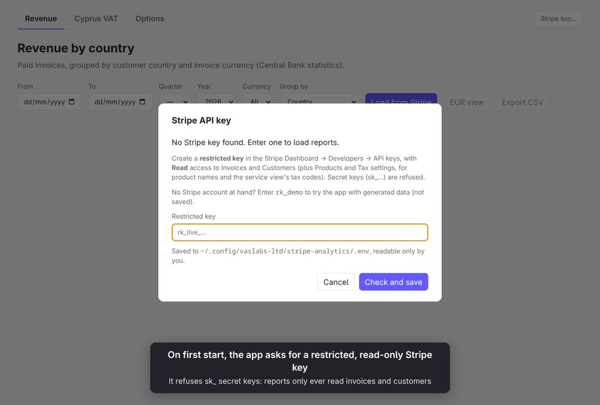

To try the app without a Stripe account, enter **`rk_demo`** as the key. The reports then show
generated data instead of calling Stripe: made-up customers in Cyprus, the EU and elsewhere, paying
in EUR, GBP and USD from January 2025 to yesterday. A few invoices are wrong on purpose so the VAT
tab has something to flag. A given month always shows the same invoices.

> **All demo data is fictional.** Customer names, emails, VAT numbers and amounts are generated
> automatically and don't describe any real person, business or transaction. Business names are
> random word pairs marked "(demo)", private customers have placeholder names (John Doe, Jane Roe, …),
> emails use the reserved `.example` domain and VAT numbers contain `DEMO`. Any resemblance to real
> people or businesses is coincidental. The same applies to the GIFs in this README, which are
> recorded in demo mode.

A banner, the window title and the **Load demo data** buttons show when it's on. Demo mode is
never saved:

- The demo key isn't written to the `.env` file and doesn't replace a saved key; restarting the
  app goes back to the real key. A `STRIPE_PASSKEY=rk_demo` in a `.env` file or the environment is
  ignored.
- The generated invoices only exist in memory.
- Changes on the Options tab (including contractors) are kept in memory too, starting from the
  saved VAT options with no contractors; `settings.json` isn't touched.
- A PIN set in demo mode, and the demo session it encrypts, are kept in memory only and never
  touch a real saved session.
- Exchange rates for demo reports use a separate cache, `demo/fx-rates.csv` in the cache folder
  below (seeded from the bundled file), so they never mix with the real one.
- CSV exports are named `demo-…csv` by default.

Entering a real key leaves demo mode, and the window reloads so no report from the other mode stays
on screen.

## Reports

The app has one tab per report.

### Revenue by country (Central Bank Services Survey, QSRVS)

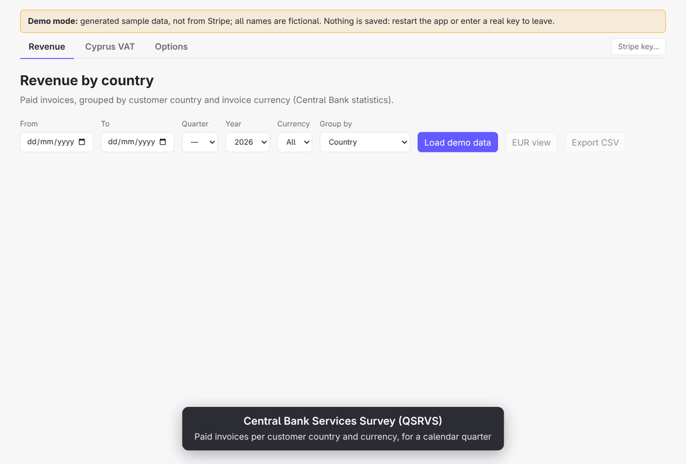

Sum of `amount_paid` across invoices with status `paid`, grouped by **customer country** and **invoice currency**.
Currencies are never converted or mixed.

The country comes from the first one of these that is set:
1. the customer's billing address (`customer.address.country`)
2. the address snapshot stored on the invoice (`invoice.customer_address.country`)
3. the customer's shipping address
4. otherwise `??` (Unknown)

The footer shows how many invoices used each source. You can filter by date range (invoice `created`, UTC) and currency, sort by any column, and export to CSV.
The Quarter/Year pickers fill in the date range for a calendar quarter; only quarters that have fully ended can be picked.

Not counted: refunds, credit notes, and invoices that are only partly paid (`open`).
Reports cover complete past days only (UTC): they always end at yesterday at the latest.

Only **EUR, GBP and USD** are supported; an invoice in any other currency stops the report with an error.

### EUR view and export

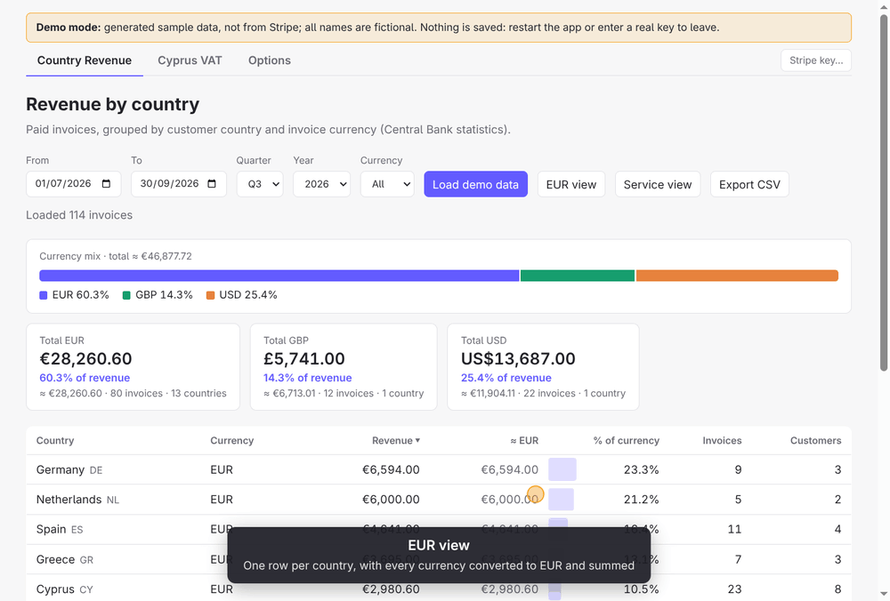

The **EUR view** button switches the table to one row per country, with every currency converted
to EUR and summed (≈ EUR, % of total, invoices, distinct customers, currencies paid in).
Export CSV exports whichever view is showing. The currency filter doesn't apply in this view.
EUR view combines with every **Group by** choice (see below).

### Service view

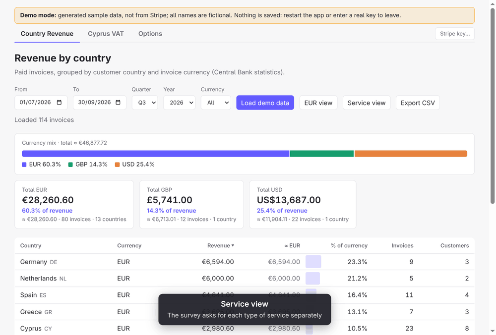

**Group by** picks what the table groups revenue by: **Country** (the views above), **Service
(tax code)**, **Product**, **Client** or **Contractor**. The last four share one layout, and **EUR view** works
with each of them. Grouping by service splits each service by country. On its
own it keeps the **invoice currencies**: a row per country and currency, with revenue in that
currency, ≈ EUR for comparison, % of total, % of the service, invoices and customers; the
currency filter applies. Percentages are always measured on the ≈ EUR amounts, since different
currencies can only be compared once converted: **% of total** is the share of all revenue, and
**% of the service** is the row's share of the service's whole revenue, across all its currencies
(so a service paid mostly in EUR and a little in GBP shows the GBP row as a small share, not 100%).
With a currency selected, the percentages still refer to all revenue and the whole service. Turn on **EUR view** as well to convert everything to EUR and get one
row per country under each service (≈ EUR, % of total, % of the service). A service is a Stripe
**tax code** (e.g. "Software as a service (SaaS) - business use", "General - Services"): the tax
code set on the product, else the account's default tax code from Tax settings. Each group lists
the products billed under it, marked "(account default)" when the code came from the default.
Each paid invoice is split across its line items in proportion to their net amounts (after
discounts, before tax), in whole cents, so the services add up exactly to the same totals as the
country views, per currency. An invoice with lines under two tax codes counts once in each.
The same columns appear for products, clients and contractors below. Every grouped CSV ends with
the group's share of all revenue (e.g. `client_share_of_total`), repeated on each of its rows.
Export CSV writes the view that's showing: one row per tax code, country and currency
(`service,tax_code,country,currency,revenue,revenue_minor_units,revenue_eur,invoices,customers,service_share_of_total`),
or with EUR view on, one row per tax code and country
(`service,tax_code,country,revenue_eur,share_of_service,share_of_total,invoices,customers,service_share_of_total`).

Stripe keeps tax codes on products, not on invoices, so this view needs **Read** access to
**Products** and **Tax settings** on the key. Without them the report still loads, with the
codes it couldn't read shown as "Tax code unknown" and a note under the table saying which
permission is missing.

### Product view

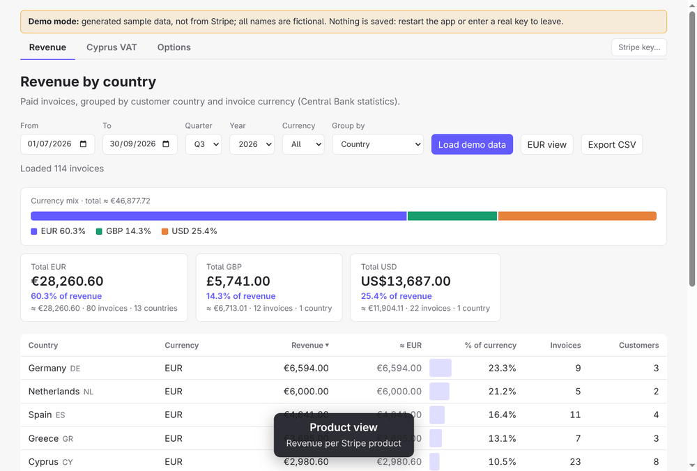

**Group by → Product** shows revenue per Stripe **product**, each split by country. Like the
service view, each paid invoice is split across its line items by net amount, in whole cents, so
the products add up exactly to the per-currency totals; lines without a product are grouped by
their description, and invoices without line items show as "Not split". In invoice currencies
there's a row per country and currency (the currency filter applies); with **EUR view** on,
products are converted, summed and shown with a product mix bar. Export CSV writes
`product,product_id,country,currency,revenue,revenue_minor_units,revenue_eur,invoices,customers,product_share_of_total`,
or with EUR view on `product,product_id,country,revenue_eur,share_of_product,share_of_total,invoices,customers,product_share_of_total`.
Product names need **Read** access to **Products**; without it products show by their line
description.

### Client view

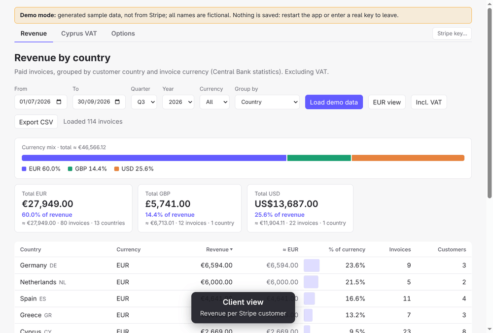

**Group by → Client** shows revenue per Stripe **customer** (the name on the invoice, else the
customer's name or email), largest first, with the customer's country and the products they paid
for. Invoices are counted whole, not split. A client paying in more than one currency, or from
more than one country, gets a row for each underneath. In invoice currencies the currency filter
applies; with **EUR view** on, every client is converted to EUR and ranked, and the mix bar shows
the top clients with the rest grouped together. Export CSV writes
`client,customer_id,country,currency,revenue,revenue_minor_units,revenue_eur,invoices,customers,client_share_of_total`,
or with EUR view on `client,customer_id,country,revenue_eur,share_of_total,invoices,customers,client_share_of_total`.
There's no "% of client" column: a client is almost always a single row.

### Contractor view

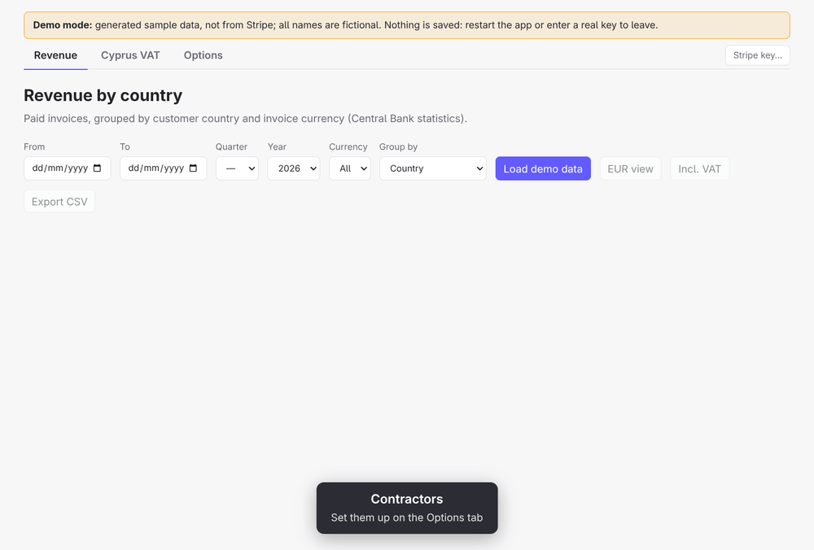

On the **Options** tab, add contractors and assign each Stripe product to one of them. The
product list (active products first, then archived ones) is loaded from Stripe the first time the
tab is opened; **Reload products from Stripe** refreshes it. The names of assigned products are
saved with the assignments, so they show even before the list loads. **Group by → Contractor**
then shows revenue per contractor: each paid invoice is split across its line items by net amount,
as in the product view, and each line goes to the contractor its product is assigned to. Lines
whose product isn't assigned, or that have no product, show as **Unassigned**, so the contractors
still add up to the same totals. Each contractor lists the products behind their revenue. **Break down by** (shown only in this
view) picks what's underneath each contractor, one at a time: **Product** (the default), **Client**
or **Country**, each with its share of the contractor (in EUR). Per client, an invoice counts once
however many of the contractor's products are on it. EUR view and the currency filter work as in
the other views. Export CSV writes
`contractor,products,product,currency,revenue,revenue_minor_units,revenue_eur,invoices,customers,contractor_share_of_total`,
or with EUR view on `contractor,products,product,revenue_eur,share_of_contractor,share_of_total,invoices,customers,contractor_share_of_total`.
The third column follows **Break down by** (`product`, `client` or `country`).
Changing an assignment regroups the report that's already loaded (and a restored session)
straight away, without calling Stripe again: the report keeps each invoice's split by product. Listing products needs
**Read** access to **Products**.

### Currency mix
To compare currencies, each invoice is converted to **EUR** at the ECB reference rate on its
payment date (`status_transitions.paid_at`). The app shows each currency's share of total revenue
and an "≈ EUR" column. Weekends and holidays use the previous ECB publication day's rate.

Rates are cached in [`data/fx-rates.csv`](data/fx-rates.csv), which is committed:

```
date,base,currency,rate,ecb_date
2026-10-04,eur,usd,1.13,2026-10-02
```

One row per calendar day and currency; `rate` is units of `currency` per 1 EUR, and `ecb_date` is
the publication day the rate came from. Only dates missing from the file are requested from
`api.frankfurter.dev` (one request covering the gap), then added to the file. Only currency
codes and dates are sent to it, never Stripe data. Commit the file after runs that add rates.
In the packaged app, the file is a cache copied on first use to:

- Linux: `~/.cache/vaslabs-ltd/stripe-analytics/fx-rates.csv` (`$XDG_CACHE_HOME` is respected)
- Windows: `%LOCALAPPDATA%\vaslabs-ltd\stripe-analytics\Cache\fx-rates.csv`

It's seeded from the old location (`~/.config/Stripe Analytics/fx-rates.csv`) if that exists, else
from the bundled file. Deleting it is safe: missing rates are fetched again. Set `FX_RATES_FILE`
to use a different path.

### Cyprus VAT

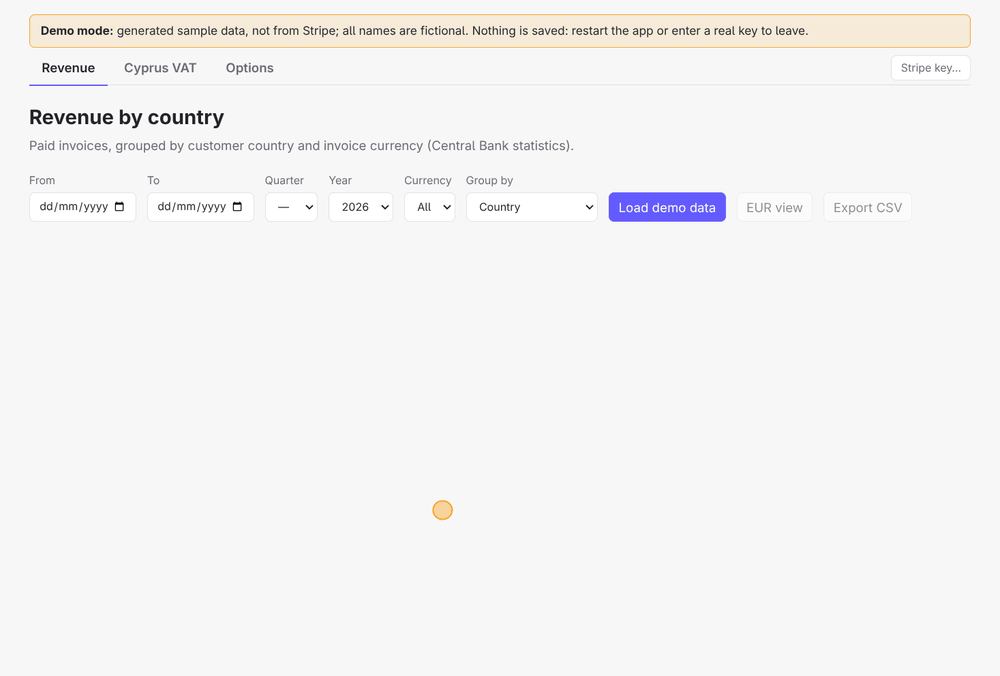

Finalized invoices (`paid`, `open`, `uncollectible` by default; see [Options](#options)) whose **invoice date**
(`effective_at`, else the finalization date) falls in the chosen VAT quarter, split into:

- **Cyprus VAT**: customers in Cyprus. Net, VAT and gross per invoice; the summary shows the
  output VAT owed for the quarter and how much of it has been collected (invoice paid).
- **VIES**: customers in other EU countries (B2B, reverse charge). Shown **per month**, with one
  line per customer VAT number, which is what the monthly VIES return asks for, plus the invoices behind it.
- **International**: everyone else (B2B, outside the scope of Cyprus VAT).

**VAT quarters.** Cyprus VAT periods have traditionally been staggered quarters starting in March:
Mar–May, Jun–Aug, Sep–Nov and Dec–Feb (which spans two calendar years). Cyprus is moving VAT
returns to calendar quarters (Jan–Mar, Apr–Jun, Jul–Sep, Oct–Dec). The quarter picker defaults to
the legacy scheme, and a scheme selector switches to calendar quarters. Pick whichever scheme your
VAT return is on for the period you're filing; for the return that covers the switch, check the
period dates the Tax Department gives you. The current quarter can be loaded too ("to date").
Amounts are converted to EUR at the ECB rate on the invoice date (same rate cache as above),
rounded per invoice. The country is the one on the invoice's address snapshot first, then the
customer's address; the VAT number is the one snapshotted on the invoice.

#### VIES, international and flagged invoices

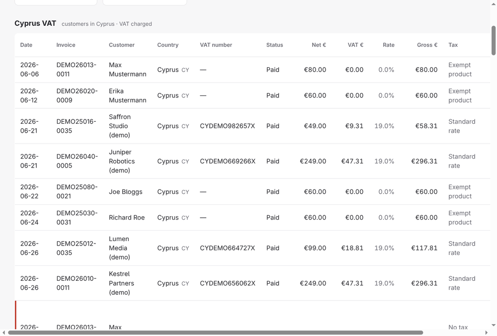

Each invoice shows its tax treatment from Stripe Tax (`taxability_reason`: standard rate, exempt
product, 0% rate, reverse charge, …), and the Cyprus summary shows how much of the net is 0%/exempt
(e.g. B2C tutoring). Rows are flagged for review when: a Cyprus invoice has no VAT *and* Stripe
recorded no exemption or 0% rate for it, an EU invoice has VAT or no
VAT number, an international invoice has VAT, or the country is unknown.
Not included: credit notes/refunds and input VAT. Export CSV writes one row per invoice.

### Options

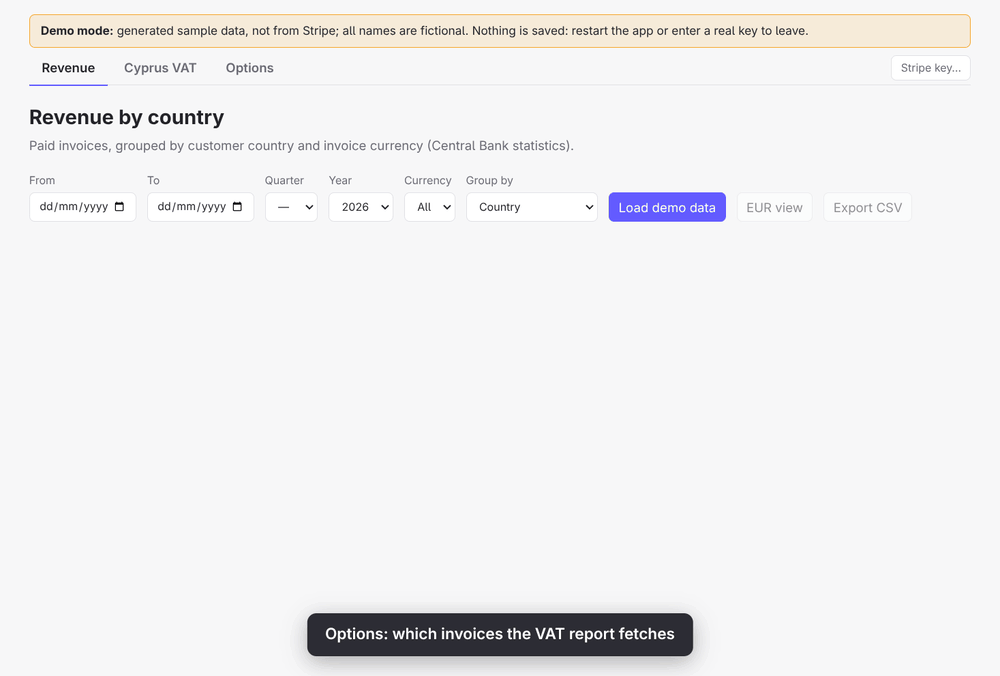

Stripe can only search invoices by the date they were **created**, but the VAT report goes by the
**invoice date**. By default it fetches invoices created within the VAT quarter, which is fastest.
The **Options** tab widens the search: also fetch invoices created 1, 3 or 12 months before the
quarter (finalized late), and/or created after it up to yesterday (back-dated into it). It also
picks the invoice statuses to include: paid, open and uncollectible by default; draft and void only
to look for mistakes (they're flagged, but counted in the totals). Changes are saved straight away
to `settings.json` in the config folder (see [Stripe key](#stripe-key-read-only)), and the VAT
report's footer says which window and statuses it searched. **Reset to defaults** resets the VAT
search only. The same tab holds the contractors and product assignments for the
[contractor view](#contractor-view).

### Last session (PIN)

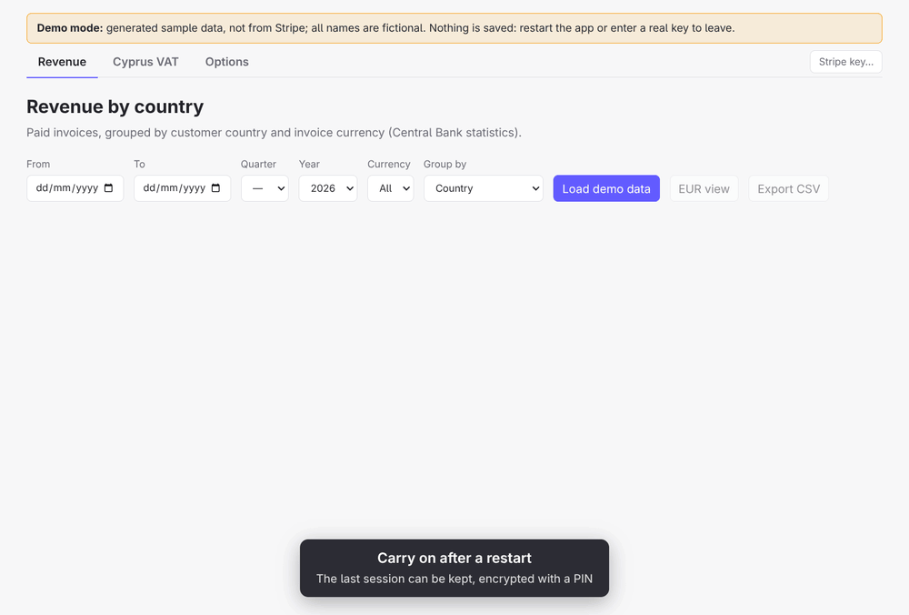

With a PIN set (Options → **Last session**, 4–8 digits), the app keeps the reports you last
loaded, with their dates, filters, grouping, EUR view and the tab you were on, and restores
them when it starts again, after you enter the PIN. Nothing is fetched from Stripe to do that.
The session is saved after every load and view change. Without a PIN nothing is kept.

- **Encryption.** Setting the PIN creates an X25519 key pair. Each saved session is sealed to the
  public key (ephemeral ECDH, HKDF-SHA256, AES-256-GCM), so saving never needs the PIN. The
  private key is sealed with a key derived (scrypt) from the **PIN together with the Stripe key**,
  so opening the session needs both. The PIN itself isn't stored anywhere.
- **Encrypting the Stripe key too** (optional checkbox). The key is sealed with the PIN alone and
  removed from the `.env` file, and the PIN is asked for at every start to unlock it. This only
  works for a key the app saved itself. A key read from the `STRIPE_PASSKEY` environment
  variable or another `.env` file would leave a plain copy behind, so the app refuses.
  Unticking it writes the key back to `.env`.
- **At start**, the app asks for the PIN only when there's something to unlock: a saved session
  or an encrypted key. **Not now** skips it (the key dialog then offers to unlock later), and
  **Forgot PIN…** deletes the PIN, the session and an encrypted key, so the app starts fresh.
- **Lock now** forgets the PIN until it's entered again, as a restart would.
- Changing the PIN, the checkbox or removing the PIN needs the current PIN. Entering a new
  Stripe key deletes the saved session (it belonged to the old key). The PIN is kept, re-encrypted
  for the new key, if it was entered since the app started; otherwise it's removed.

The files are `session-lock.json` and `last-session.json` in the config folder (see
[Stripe key](#stripe-key-read-only)), readable only by you. A 4–8 digit PIN keeps them from being
read casually, but scrypt only slows guessing down: someone with a copy of the files and enough
time could try every PIN, and if the Stripe key is encrypted as well, everything rests on the PIN.

## Stripe key (read-only)

Create a **restricted key** in the Stripe Dashboard → Developers → API keys, with **Read** access to:
- Invoices
- Customers
- Products and Tax settings (optional: product names, the product list for contractors, and tax
  codes for the service view)

The app won't start a query with a standard `sk_` secret key; it accepts only `rk_` restricted keys.

**On first start, the app asks for the key** if it can't find one (or finds a non-restricted
one). It checks the key with one read call each to Invoices and Customers, then saves it to:

- Linux: `~/.config/vaslabs-ltd/stripe-analytics/.env` (`$XDG_CONFIG_HOME` is respected)
- Windows: `%APPDATA%\vaslabs-ltd\stripe-analytics\.env`

as `STRIPE_PASSKEY=rk_...`, readable only by you (mode 600 on Linux). The **Stripe key…** button
replaces it. You can also write that file yourself. It can be kept encrypted with a PIN instead
(see [Last session](#last-session-pin)).

The key is read from the first of these that exists: `.env` in the current directory (handy for
`npm start`), the file above, then the old location (`~/.config/Stripe Analytics/.env`).
A `STRIPE_PASSKEY` environment variable wins over all of them. After you type it in, the key
stays in the Electron main process and is never sent back to the UI.

## Development

```sh
npm install
npm start        # build and launch
npm test         # unit tests for the aggregation
npm run typecheck
```

### Demo GIFs

The GIFs in this README are recorded from the real app in demo mode by
[`scripts/demo-gifs/record.mjs`](scripts/demo-gifs/record.mjs), so they can be regenerated
whenever the UI changes:

```sh
npm run gifs              # all of them, into docs/gifs/
npm run gifs -- vat vies  # only some scenes
xvfb-run npm run gifs     # on a machine without a display
```

It needs `ffmpeg` on the `PATH`. [Playwright](https://playwright.dev) (`playwright-core`, no
browser download) drives the app; captions, the highlight and the pointer are added to the page
for the recording. Each scene is a short list of steps (move, click, caption, hold), one GIF per
scene. The app runs with temporary config and cache folders and no `STRIPE_PASSKEY`, so a real key
or real Stripe data can't end up in a recording.

## Download

Get the latest build from the GitHub **Releases** page:

- Linux: `stripe-analytics-<version>-x86_64.AppImage`
- Windows: `stripe-analytics-<version>-setup-x64.exe`

Each file has a `.sha256` checksum next to it.

To run it on Linux:

```sh
chmod +x stripe-analytics-0.2.0-x86_64.AppImage
./stripe-analytics-0.2.0-x86_64.AppImage   # asks for the Stripe key on first start
```

AppImages need FUSE (`sudo dnf install fuse-libs` on Fedora, `sudo apt install libfuse2` on Debian/Ubuntu).

On Windows, run `stripe-analytics-0.2.0-setup-x64.exe`. It installs for the current user (no admin
rights) and adds a Start-menu entry. The installer isn't code-signed, so SmartScreen asks first:
**More info → Run anyway**.

## Releases (CI)

CI never needs the Stripe key.

### GitHub Actions

[`.github/workflows/ci.yml`](.github/workflows/ci.yml) runs the typecheck and tests, then builds
the AppImage (Ubuntu runner) and the Windows installer (Windows runner). On pull requests the
files are kept as run artifacts for 30 days.

**Every push to `master` is released automatically.** The workflow tags the commit with the next
version and creates a GitHub Release with both files and their checksums. The version
([`scripts/next-version.mjs`](scripts/next-version.mjs)) is the next patch after the newest
`vX.Y.Z` tag. For a minor or major release, set a higher `version` in `package.json` and push;
that version is used as-is.

### GitLab CI

[`.gitlab-ci.yml`](.gitlab-ci.yml) builds the same two files on every pipeline (job artifacts,
kept for 30 days). Tags like `v0.2.0` also upload them to the project's package registry and
create a GitLab Release:

```sh
git tag v0.2.0 && git push origin v0.2.0
```

The `windows` job cross-compiles on a Linux runner (`node:22-bookworm`). electron-builder runs the
Windows resource tools through Wine, and the NSIS installer runs a 32-bit stub to build its
uninstaller, so the job installs Debian's `wine`, `wine64` and `wine32:i386`.

## Packaging locally

```sh
sudo dnf install rpm-build   # needed for the rpm target
npm run dist                 # writes an AppImage and an .rpm to release/
npm run dist:appimage        # AppImage only (what CI builds)
sudo dnf install wine        # needed for the Windows build
npm run dist:win             # Windows installer: release/stripe-analytics-<version>-setup-x64.exe
```

## Layout

```
src/main/      Electron main process: Stripe client, aggregation, IPC
src/preload/   contextBridge API exposed to the UI
src/renderer/  UI (sandboxed, no Node access)
src/shared/    types shared by main and renderer
```

## License

[MIT](LICENSE) © Vaslabs Ltd
